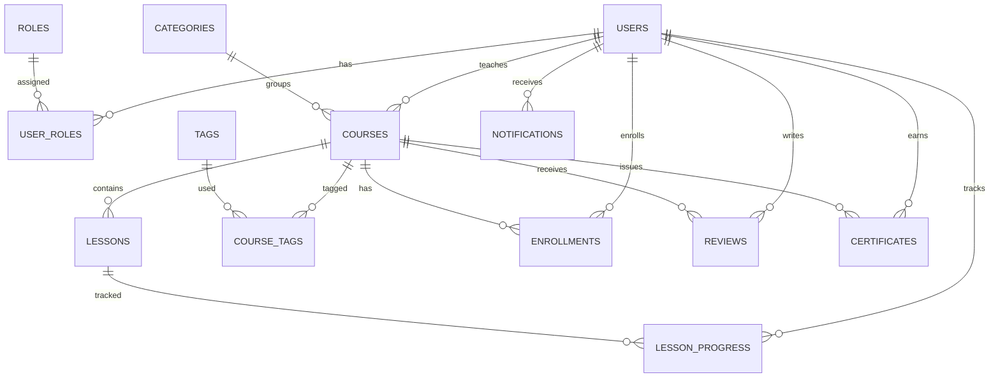

# 🎓 Learning Platform App

A REST API for an online learning platform (a mini Udemy) built with **Spring Boot**. Instructors publish courses, admins review and approve them, and students enroll, track their lesson progress, leave reviews, and earn a **PDF certificate** when they finish a course.


---

## 📋 Table of Contents

- [Features](#-features)
- [Tech Stack](#-tech-stack)
- [Roles & Permissions](#-roles--permissions)
- [Course Lifecycle](#-course-lifecycle)
- [Database](#-database)
- [API Endpoints](#-api-endpoints)
- [Getting Started](#-getting-started)
- [Project Structure](#-project-structure)
- [Screenshots](#-screenshots)

---

## ✨ Features

**Students**
- Register and log in with JWT authentication.
- Browse published courses and search by keyword, category, or level.
- Enroll in a course and cancel an enrollment.
- Mark lessons as completed and track progress per course.
- Rate and review enrolled courses.
- Generate a **PDF certificate** after completing all lessons, and download it.
- In-app notifications (enrollment, course completion, certificate issued, ...).

**Instructors**
- Create, update, and archive courses.
- Add, update, and delete lessons (video URL, duration, order).
- Attach tags to courses.
- Submit courses for review and get notified when they are published or rejected (with the rejection reason).

**Admins**
- Review pending courses and approve or reject them with a reason.
- Platform dashboard (total users, courses by status, enrollments, reviews) and per-course statistics (enrollment count, review count, average rating).
- User management: update roles and enable/disable accounts.
- Tag management.

**General**
- Public certificate verification by certificate number (no login required).
- Full interactive API documentation with Swagger UI.
- Centralized error handling (`GlobalExceptionHandler`) with clean JSON responses for 401 and 403 errors.

---

## 🛠 Tech Stack

| Area | Technology |
|---|---|
| Language | Java 21 |
| Framework | Spring Boot 4.1.1 (Spring MVC) |
| Database | MySQL + Spring Data JPA / Hibernate |
| Security | Spring Security + JWT (jjwt 0.12.6), stateless |
| Input validation | Spring Validation (Jakarta Bean Validation) |
| Entity ↔ DTO mapping | MapStruct 1.6.3 |
| Boilerplate reduction | Lombok |
| API docs | springdoc-openapi 3.2.0 (Swagger UI) |
| PDF generation | OpenPDF 3.0.5 |
| Build tool | Maven (Maven Wrapper included) |

**Architecture:** Controller → Service → Repository, with separate request/response DTOs, mappers, and centralized exception handling.

---

## 🔐 Roles & Permissions

There are three roles: `STUDENT`, `INSTRUCTOR`, and `ADMIN`.

- Every new account is registered with the **STUDENT** role automatically.
- Admins change roles (for example, promote a user to instructor) via `PUT /api/v1/users/{userId}/roles`.
- Send the token in the `Authorization` header:

```
Authorization: Bearer <token>
```

- Token lifetime: **15 minutes** (`jwt.expiration-ms=900000`).

---

## 🔄 Course Lifecycle

```
DRAFT ──(instructor submits)──▶ PENDING_REVIEW ──(admin approves)──▶ PUBLISHED
              ▲                        │
              │                        └──(admin rejects + reason)──▶ REJECTED
              └──────(instructor edits and resubmits)───────────────────┘

Any course ──(instructor deletes)──▶ ARCHIVED   (not allowed if students are enrolled)
```

Business rules:
- A course must contain **at least one lesson** before it can be submitted for review.
- Only courses in `PENDING_REVIEW` can be approved or rejected.
- Students can only see and enroll in `PUBLISHED` courses.
- `lesson_order` must be unique within a course.

**Student rules:**
- A student cannot enroll in the same course twice.
- Only enrolled students can review a course, and only one review per student per course.
- A certificate requires enrollment **and** completion of **all** lessons, and only one certificate is issued per course.
- Only the certificate owner can download it.

---

## 🗄 Database

The project uses **MySQL**, and Hibernate is configured with `ddl-auto=validate`. This means **tables are not created automatically**. You must create them with the SQL script before starting the app.

> 📁 Schema script: [`database/schema.sql`](database/schema.sql)

### Tables

| Table | Description |
|---|---|
| `users` | User accounts |
| `roles` | Roles (STUDENT / INSTRUCTOR / ADMIN) |
| `user_roles` | User ↔ role link (many-to-many) |
| `categories` | Course categories |
| `courses` | Courses |
| `tags` | Tags |
| `course_tags` | Course ↔ tag link (many-to-many) |
| `lessons` | Course lessons |
| `lesson_progress` | Each student's progress per lesson |
| `enrollments` | Student enrollments in courses |
| `reviews` | Course reviews |
| `certificates` | Issued certificates |
| `notifications` | User notifications |

### Entity Relationship Diagram




### ⚠️ Data you must insert manually

1. **Roles** in the `roles` table: `STUDENT`, `INSTRUCTOR`, and `ADMIN` must exist (registration fails if `STUDENT` is missing).
2. **The first admin**: since every new account gets the STUDENT role, grant the first admin role directly in the database (insert a row into `user_roles`).
3. **Categories** in the `categories` table: every course must belong to a category, and there is currently no endpoint for creating categories.

---

## 📡 API Endpoints

All paths are prefixed with `/api/v1`. Full interactive documentation is available in Swagger UI.

### Auth
| Method | Path | Access |
|---|---|---|
| POST | `/auth/register` | Public |
| POST | `/auth/login` | Public |

### Users
| Method | Path | Access |
|---|---|---|
| GET | `/users/me` | Authenticated |
| PATCH | `/users/me` | Authenticated |
| PATCH | `/users/me/password` | Authenticated |
| PUT | `/users/{userId}/roles` | ADMIN |
| PATCH | `/users/{userId}/status` | ADMIN |

### Courses
| Method | Path | Access |
|---|---|---|
| GET | `/courses` | Public (paged: `page`, `size`) |
| GET | `/courses/search` | Public (`keyword`, `categoryId`, `level`, `page`, `size`) |
| GET | `/courses/{id}` | Public |
| POST | `/courses` | INSTRUCTOR |
| PUT | `/courses/{id}` | INSTRUCTOR |
| DELETE | `/courses/{id}` | INSTRUCTOR (archives the course) |
| POST | `/courses/{courseId}/submit-for-review` | INSTRUCTOR |
| PUT | `/courses/{courseId}/tags` | INSTRUCTOR |
| PATCH | `/courses/{courseId}/approve` | ADMIN |
| PATCH | `/courses/{courseId}/reject` | ADMIN |
| GET | `/courses/{courseId}/statistics` | ADMIN |

### Lessons
| Method | Path | Access |
|---|---|---|
| GET | `/courses/{courseId}/lessons` | Public |
| POST | `/courses/{courseId}/lessons` | INSTRUCTOR |
| PUT | `/courses/{courseId}/lessons/{lessonId}` | INSTRUCTOR |
| DELETE | `/courses/{courseId}/lessons/{lessonId}` | INSTRUCTOR |

### Enrollments
| Method | Path | Access |
|---|---|---|
| POST | `/courses/{courseId}/enrollments` | STUDENT |
| GET | `/students/me/enrollments` | STUDENT |
| PATCH | `/courses/{courseId}/enrollments/cancel` | STUDENT |

### Lesson Progress
| Method | Path | Access |
|---|---|---|
| PUT | `/lessons/{lessonId}/progress/complete` | STUDENT |
| GET | `/lessons/courses/{courseId}/progress` | STUDENT |

### Reviews
| Method | Path | Access |
|---|---|---|
| GET | `/courses/{courseId}/reviews` | Public |
| POST | `/courses/{courseId}/reviews` | STUDENT |
| PUT | `/reviews/{reviewId}` | STUDENT |
| DELETE | `/reviews/{reviewId}` | STUDENT |

### Certificates
| Method | Path | Access |
|---|---|---|
| POST | `/courses/{courseId}/certificates` | STUDENT |
| GET | `/certificates/my-certificates` | STUDENT |
| GET | `/certificates/{certificateNumber}/download` | STUDENT |
| GET | `/certificates/verify/{certificateNumber}` | Public |

### Tags
| Method | Path | Access |
|---|---|---|
| GET | `/tags`, `/tags/{id}` | Public |
| POST | `/tags` | INSTRUCTOR / ADMIN |
| PUT | `/tags/{id}` | ADMIN |
| DELETE | `/tags/{id}` | ADMIN |

### Notifications
| Method | Path | Access |
|---|---|---|
| GET | `/notifications` | Any authenticated user |
| GET | `/notifications/unread-count` | Any authenticated user |
| PATCH | `/notifications/{id}/read` | Any authenticated user |
| PATCH | `/notifications/read-all` | Any authenticated user |
| DELETE | `/notifications/{id}` | Any authenticated user |

### Admin
| Method | Path | Access |
|---|---|---|
| GET | `/admin/courses/pending` | ADMIN |
| GET | `/admin/dashboard` | ADMIN |

---

## 🚀 Getting Started

### Prerequisites
- JDK 21
- MySQL 8+
- Maven is not required (the Maven Wrapper is included)

### Steps

**1. Clone the repository**
```bash
git clone https://github.com/mousa604/Learning-Platform-App.git
cd Learning-Platform-App
```

**2. Create the database and tables**
```sql
CREATE DATABASE learning_platform CHARACTER SET utf8mb4 COLLATE utf8mb4_unicode_ci;
USE learning_platform;
SOURCE database/schema.sql;
```
Then insert the roles and categories (see "Data you must insert manually" in the Database section above).

**3. Set environment variables**

The app reads its sensitive settings from environment variables:

| Variable | Description | Example |
|---|---|---|
| `DB_URL` | Database JDBC URL | `jdbc:mysql://localhost:3306/learning_platform` |
| `DB_USERNAME` | MySQL username | `root` |
| `DB_PASSWORD` | MySQL password | `your_password` |
| `JWT_SECRET` | Secret key used to sign JWTs | a long random string |

Linux / macOS:
```bash
export DB_URL="jdbc:mysql://localhost:3306/learning_platform"
export DB_USERNAME="root"
export DB_PASSWORD="your_password"
export JWT_SECRET="put-a-long-random-secret-here"
```

Windows (PowerShell):
```powershell
$env:DB_URL="jdbc:mysql://localhost:3306/learning_platform"
$env:DB_USERNAME="root"
$env:DB_PASSWORD="your_password"
$env:JWT_SECRET="put-a-long-random-secret-here"
```

**4. Run the application**
```bash
./mvnw spring-boot:run        # Linux / macOS
mvnw.cmd spring-boot:run      # Windows
```

The app starts on `http://localhost:8080`.

**5. Open Swagger UI**

👉 `http://localhost:8080/swagger-ui.html`

To try protected endpoints: log in via `/auth/login`, copy the token, and click **Authorize** in Swagger.

### Profiles
- `dev` (default): verbose logging with SQL statements printed.
- `prod`: reduced logging, no SQL output.

Switch profiles with `--spring.profiles.active=prod`.

Logs are written to `logs/learning-platform.log`, and generated certificates are stored in `uploads/certificates/`.

---

## 📂 Project Structure

```
src/main/java/com/example/LearningPlatformApp/
├── config/        # Security, OpenAPI, password encoder
├── controller/    # REST controllers
├── dto/           # Request / response / auth DTOs
├── entity/        # JPA entities and enums
├── exception/     # Custom exceptions + GlobalExceptionHandler
├── mapper/        # MapStruct mappers
├── repository/    # Spring Data JPA repositories
├── security/      # JWT service, filter, and handlers
└── service/       # Business logic
src/main/resources/
├── application.properties
├── application-dev.properties
└── application-prod.properties
---